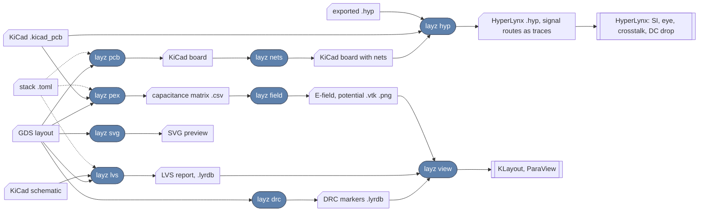

<p align="center"></p>

Layout tools for SiLab's FR4 PCBs, in-house RDL chips (maskless lithography) and the flex PCBs
that connect them, as one command line tool. Install: [install.md](install.md).

```
layz drc       design rule check of a GDS (gdscheck, with the kit's deck)
layz lvs       GDS connectivity vs a KiCad schematic (net and pin labels)
layz pcb       GDS -> KiCad .kicad_pcb (copper zones, footprints, vias, outline, stackup)
layz nets      assign zone/via nets from a seed footprint's pad nets
layz hyp       .kicad_pcb, GDS or .hyp -> HyperLynx .hyp (signal pours as traces)
layz svg       GDS -> SVG preview
layz pex       3-D capacitance matrix with FasterCap/FastCap2 (.kicad_pcb, or GDS + stack)
layz field     electric field and potential from a `layz pex --charges` run
layz view      open a result: DRC/LVS markers in KLayout, ParaView renders of a field run
layz doctor    which external tools this machine has
```

`layz <command> -h` shows each command's options.

## Pipeline



Process data lives in the repo: [stacks/](stacks/readme.md) (layer heights, εr, GDS mapping per
process) and [drc/](drc/uni-bonn-rdl/readme.md) (rule decks per kit). Reference designs are in
`example_files/` (obelix1 ladder GDS, its KiCad schematic, Andreas' KiCad-exported `.hyp`).

## layz drc

Design rule check with [gdscheck](https://github.com/aesc-silicon/gdscheck) and a kit's deck.

```sh
layz drc --lay design.gds --kit uni-bonn-rdl              # -> design.lyrdb
layz drc --lay design.gds --kit uni-bonn-rdl --suite geometry   # without density
layz drc --lay design.gds --kit uni-bonn-rdl --benchmark  # time each rule, no report
layz view design.lyrdb --lay design.gds                   # KLayout with the markers
```

`--tile` sets gdscheck's merge tile (default 20 mm: board/RDL scale); `-v` lists every
violation. Rules of the RDL kit: [drc/uni-bonn-rdl](drc/uni-bonn-rdl/readme.md).

## layz lvs

Compares a layout's connectivity with a KiCad schematic, net by net (interconnect has no
devices to recognise). KLayout extracts the nets from the stack's copper and via layers; text
labels say what each net is meant to be.

```sh
layz lvs --lay design.gds --stack stacks/uni_bonn_rdl.toml --sch design.kicad_sch
layz lvs --lay design.gds --stack stacks/uni_bonn_rdl.toml --sch design.net --report lvs.lyrdb
layz view lvs.lyrdb --lay design.gds
```

**Labels.** A label names the net whose copper its **origin** lies on:

* **pin label**: text = `REF.PIN` of a schematic pin (`V4.102`); put one on the pad at each end
  of a route and every connection is checked against the schematic;
* **net label**: text = a schematic net name (`D4_N` or `/D4_N`, case-insensitive).

They go on each metal's **pin layer: the same layer number, datatype 1** (M3 drawn on 6/0 is
labelled on 6/1, M2 3/0 on 3/1, pads 8/0 on 8/1). Texts on the drawing layer itself count too;
a stack can name other label layers (`labels = [...]`), and `--labels 80/7:6/0` ties a generic
label layer to one metal.

**Reported:** open (one schematic net on several layout nets), short (one layout net carrying
several schematic nets), unknown (a label naming nothing in the schematic), floating (a label on
no copper), and the schematic nets no label covers. Exit status 1 on opens, shorts or unknown
labels. A chip's own pad names (VINA, VDDA, …) are not board nets: label the board on the pin
layers.

## layz pcb, layz nets

GDS -> KiCad board, then nets from a seed footprint.

```sh
layz pcb --lay design.gds --stack stacks/uni_bonn_rdl.toml          # -> design.kicad_pcb
# KiCad: Update PCB from Schematic (references and the seed footprint's pad nets)
layz nets design.kicad_pcb --seed-footprint VTX2       # -> design_nets_assigned.kicad_pcb
layz nets design.kicad_pcb --dry-run                   # report only
```

`pcb`: GDS cells with pad-layer shapes become footprints (one per cell and orientation),
top-level copper becomes filled zones, via layers become blind/buried vias, the outline layer
becomes Edge.Cuts, and the stack becomes the board's physical stackup; Y is flipped so the board
shows the GDS top view (`--no-flip-y` keeps it raw). `--layer-map 3/0=In2.Cu` and
`--via-map 7/0=F.Cu,In1.Cu` override single entries of the stack's mapping.
`nets`: nets propagate from the seed footprint's pads through touching copper and vias.

## layz hyp

HyperLynx `.hyp` from a KiCad board, a GDS (through `layz pcb`), or an existing `.hyp`.

```sh
layz hyp board.kicad_pcb                                  # -> board.hyp
layz hyp design.gds --stack stacks/uni_bonn_rdl.toml      # GDS -> board -> .hyp in one step
layz hyp exported.hyp -o with_traces.hyp                  # rewrite a .hyp exported elsewhere
layz hyp board.kicad_pcb --traces none                    # KiCad's own output
layz hyp board.kicad_pcb --traces /CLK_P,/CLK_N           # traces for just these nets
```

The writer reproduces KiCad's GUI exporter (records and number format). **Signal routes as
traces** (`--traces auto`, the default): a GDS draws every route as a polygon, which KiCad
exports as a pour, and HyperLynx BoardSim builds transmission lines, loss and crosstalk only from
traces. So strip-shaped pours of signal nets are written as their centreline (SEG records), as
wide as the strip and run into the pads, vias and pins at their ends; supplies and planes stay
pours (right for DC drop). `auto` takes nets with ≥ 2 pins that are ≥ 95 % strips no wider than
`--trace-max-width` (0.08 mm). On the obelix1 export that is the 17 signal nets (CLK, CMD, rst,
D1–D4, ADC_1–4: 40 µm, 9 to 131 mm), which HyperLynx then sees with their lengths and coupling.

## layz pex, layz field

3-D capacitance matrix (FasterCap, or FastCap2), and the field of a solved run.

```sh
layz pex board.kicad_pcb                                  # stack from the board
layz pex chip.gds --stack stacks/uni_bonn_rdl.toml        # stack from the file
layz pex chip.gds --stack stacks/uni_bonn_rdl.toml --list # just list the conductors
layz pex board.kicad_pcb --charges --out run              # keep charges for field plots
layz field run --voltage TOP=1                            # 3-D grid -> run/field.vtk
layz field run --voltage TOP=1 --plane y=5000             # cross-section, PNG + VTK
layz field run --probe 100,200,30                         # φ and E at one point
layz view section run/section_y5000_edge.vtk              # ParaView: heatmap + field lines
layz view geometry run                                    # ParaView: the 3-D model
```

A conductor is any copper that touches or is joined by vias, named by net (KiCad), by GDS texts
or `--name NAME=LAYER@X,Y`. Results: `maxwell_matrix_fF.csv` (Maxwell convention: diagonal
total, off-diagonal −mutual) and `spice_caps_fF.csv`. **Keep `--tolerance` at 1 % or tighter**
(the default): with dielectrics FasterCap's first passes can be far off without an error.
`--voltage` sets conductor voltages for the field only; any bias is a superposition of the solved
columns, so it needs no new solve.

## layz svg, layz view, layz doctor

```sh
layz svg design.gds design.svg --width-px 2000            # quick preview
layz view design.lyrdb --lay design.gds                   # DRC/LVS markers in KLayout
layz view {section,geometry,field} ...                    # ParaView renders (each takes -h)
layz doctor                                               # which tools are installed
```
