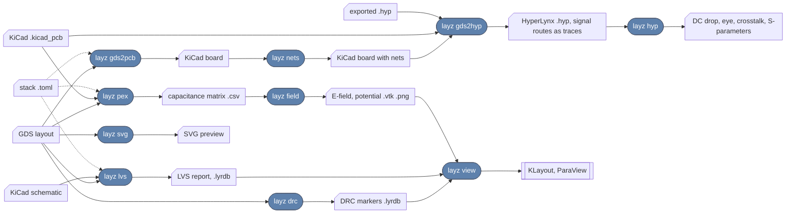

<p align="center"></p>

Layout tools for SiLab's FR4 PCBs, in-house RDL chips (maskless lithography) and the flex PCBs
that connect them, as one command line tool. Install: [docs/install.md](docs/install.md).

```
layz drc       design rule check of a GDS (gdscheck, with the kit's deck)
layz lvs       GDS connectivity vs a KiCad schematic (net and pin labels)
layz gds2pcb   GDS -> KiCad .kicad_pcb (copper zones, footprints, vias, outline, stackup)
layz nets      assign zone/via nets from a seed footprint's pad nets
layz gds2hyp   GDS, .kicad_pcb or .hyp -> HyperLynx .hyp (signal pours as traces)
layz hyp       HyperLynx headless on a .hyp: DC drop, SI, eye, crosstalk, S-parameters
layz svg       GDS -> SVG preview
layz pex       3-D capacitance matrix with FasterCap/FastCap2 (.kicad_pcb, or GDS + stack)
layz field     electric field and potential from a `layz pex --charges` run
layz view      open a result: DRC/LVS markers in KLayout, ParaView renders of a field run
layz doctor    which external tools this machine has, then the tests
```

`layz <command> -h` shows each command's options.

## Pipeline



## Repository

```text
layz/
├── layz/                 the layz package, one folder per command:
│   ├── drc/  lvs/        layz drc, layz lvs
│   ├── gds2pcb/          layz gds2pcb, layz nets
│   ├── gds2hyp/          layz gds2hyp (traces.py: pours -> traces)
│   ├── hyperlynx/        layz hyp (runner/: scripts in HyperLynx's own Python)
│   ├── pex/  field/      layz pex, layz field (field/paraview/: layz view's scripts)
│   ├── svg/              layz svg
│   └── cli.py, doctor.py, stack.py, plotstyle.py, solvers.py
├── tech/                 processes: stack file, DRC deck, notes
│   ├── uni-bonn-rdl/
│   └── multicb/          Multi-CB FR4 and flex buildups
├── designs/              real designs and their flows (ivtx_rdl: the obelix1 ladder)
├── test/                 layz's tests and their small test designs (run by layz doctor)
├── docs/                 install, stack file format, images
├── install.sh            install layz and its tools, per user, no sudo
└── install/              system.sh (the system packages, once per machine, by an admin) and
                          the steps install.sh runs: layz, fastercap, gdscheck, paraview, kicad
```

A process is given by name (`--stack uni-bonn-rdl`, `--kit uni-bonn-rdl`) or as a stack file;
the format is in [docs/stacks.md](docs/stacks.md).

## layz drc

Design rule check with [gdscheck](https://github.com/aesc-silicon/gdscheck) and a kit's deck.

```sh
layz drc --lay design.gds --kit uni-bonn-rdl              # -> design.lyrdb
layz drc --lay design.gds --kit uni-bonn-rdl --suite geometry   # without density
layz drc --lay design.gds --kit uni-bonn-rdl --benchmark  # time each rule, no report
layz view design.lyrdb --lay design.gds                   # KLayout with the markers
```

`--tile` sets gdscheck's merge tile (default 20 mm: board/RDL scale); `-v` lists every
violation. Rules of the RDL kit: [tech/uni-bonn-rdl](tech/uni-bonn-rdl/readme.md).

## layz lvs

Compares a layout's connectivity with a KiCad schematic, net by net (interconnect has no
devices to recognise). KLayout extracts the nets from the stack's copper and via layers; text
labels say what each net is meant to be.

```sh
layz lvs --lay design.gds --stack uni-bonn-rdl --sch design.kicad_sch
layz lvs --lay design.gds --stack uni-bonn-rdl --sch design.net --report lvs.lyrdb
layz view lvs.lyrdb --lay design.gds
```

**Labels.** A label names the net whose copper its **origin** lies on:

* **pin label**: text = `REF.PIN` of a schematic pin (`V4.102`); put one on the pad at each end
  of a route and every connection is checked against the schematic;
* **net label**: text = a schematic net name (`D4_N` or `/D4_N`, case-insensitive).

They go on each metal's **pin layer: the same layer number, datatype 1** (M3 drawn on 6/0 is
labelled on 6/1, M2 3/0 on 3/1, pads 8/0 on 8/1). Texts on the drawing layer itself count too;
a stack can name other label layers (`labels = [...]`), and `--labels 80/7:6/0` ties a generic
label layer to one metal.

**Reported:** open (one schematic net on several layout nets), short (one layout net carrying
several schematic nets), unknown (a label naming nothing in the schematic), floating (a label on
no copper), and the schematic nets no label covers. Exit status 1 on opens, shorts or unknown
labels. A chip's own pad names (VINA, VDDA, …) are not board nets: label the board on the pin
layers.

## layz gds2pcb, layz nets

GDS -> KiCad board, then nets from a seed footprint.

```sh
layz gds2pcb --lay design.gds --stack uni-bonn-rdl          # -> design.kicad_pcb
# KiCad: Update PCB from Schematic (references and the seed footprint's pad nets)
layz nets design.kicad_pcb --seed-footprint VTX2       # -> design_nets_assigned.kicad_pcb
layz nets design.kicad_pcb --dry-run                   # report only
```

`pcb`: GDS cells with pad-layer shapes become footprints (one per cell and orientation),
top-level copper becomes filled zones, via layers become blind/buried vias, the outline layer
becomes Edge.Cuts, and the stack becomes the board's physical stackup; Y is flipped so the board
shows the GDS top view (`--no-flip-y` keeps it raw). `--layer-map 3/0=In2.Cu` and
`--via-map 7/0=F.Cu,In1.Cu` override single entries of the stack's mapping.
`nets`: nets propagate from the seed footprint's pads through touching copper and vias.

## layz gds2hyp

HyperLynx `.hyp` from a GDS (through `layz gds2pcb`), a KiCad board, or an existing `.hyp`.

```sh
layz gds2hyp board.kicad_pcb                              # -> board.hyp
layz gds2hyp design.gds --stack uni-bonn-rdl  # GDS -> board -> .hyp in one step
layz gds2hyp exported.hyp -o with_traces.hyp              # rewrite a .hyp exported elsewhere
layz gds2hyp board.kicad_pcb --traces none                # KiCad's own output
layz gds2hyp board.kicad_pcb --traces /CLK_P,/CLK_N       # traces for just these nets
```

The writer reproduces KiCad's GUI exporter (records and number format). **Signal routes as
traces** (`--traces auto`, the default): a GDS draws every route as a polygon, which KiCad
exports as a pour, and HyperLynx BoardSim builds transmission lines, loss and crosstalk only from
traces. So strip-shaped pours of signal nets are written as their centreline (SEG records), as
wide as the strip and run into the pads, vias and pins at their ends; supplies and planes stay
pours (right for DC drop). `auto` takes nets with ≥ 2 pins that are ≥ 95 % strips no wider than
`--trace-max-width` (0.08 mm). On the obelix1 export that is the 17 signal nets (CLK, CMD, rst,
D1–D4, ADC_1–4: 40 µm, 9 to 131 mm), which HyperLynx then sees with their lengths and coupling.

## layz hyp

Runs HyperLynx's BoardSim (VX.2.14 / 2409; licensed) headless through HyperLynx's own Python,
as the **targets** of a design's flow: `designs/<design>/flow.py` defines each step as a
function decorated `@target`, without arguments or return value. A target takes the inputs it
needs, runs the simulation, checks the results against the design's limits and plots them into
its own output folder. `layz hyp` runs them by name:

```sh
export MGLS_LICENSE_FILE=27504@nexus.physik.uni-bonn.de   # the license server
layz hyp -d ivtx_rdl                                      # list the design's targets
layz hyp -d ivtx_rdl setup                                # HyperLynx overlay + the board
layz hyp -d ivtx_rdl dc si                                # run some, in this order
layz hyp -d ivtx_rdl all                                  # all, in the file's order
layz hyp -f path/to/flow.py TARGET                        # a flow file elsewhere (default ./flow.py)
```

The usual targets are `setup`, `info`, `dc`, `si` and `sparams`. Each names its own files, nets,
limits and every HyperLynx setting it uses (no defaults: `layz.hyperlynx.run` documents them),
so it reads on its own; one from
[designs/ivtx_rdl/flow.py](designs/ivtx_rdl/flow.py):

```python
from pathlib import Path
from layz.hyperlynx import analysis, plots, run, target


@target
def dc():
    """DC drop of the 3 V rails and their returns, against 5 %."""
    board = Path("results/ivtx_rdl/setup/obelix1_ivtx_ladder_with_nets_v3.1.hyp")
    if not board.exists():
        setup()
    out = Path("results/ivtx_rdl/dc")
    supply = run.dc(board, out / "supply", license="HyperLynx SI/PI", nets=["/3V_1", "/3V_2", "/3V_3", "/3V_4"], include_ref=True, max_voltage_drop=5.0, max_current_density=1.5e7, max_via_current=1.0, return_from=None, return_vrm_type="simple", return_sink_resistance=1e6)
    ret = run.dc(board, out / "return", license="HyperLynx SI/PI", nets=["/3V_1", "/3V_2", "/3V_3", "/3V_4"], include_ref=True, max_voltage_drop=5.0, max_current_density=1.5e7, max_via_current=1.0, return_from=supply / "ports.csv", return_vrm_type="simple", return_sink_resistance=1e6)
    analysis.dc_drop(supply, max_drop=0.05, out=out / "dc_drop.csv")
    plots.plot_dc(supply, out, ret)
```

The analyses (`layz.hyperlynx.run`) each copy the board into a run folder (with its `.bud`/`.pjh`
project: VRMs, DC sinks, pin models made in the GUI) and run there:

* `run.info`: stackup, nets with their lengths, VRMs, modelled pins.
* `run.dc`: DC drop: pin voltages and currents, every via's current, HyperLynx's CSV report,
  its PowerScope file and loss map; `return_from=` re-solves the return nets as the supply
  (HyperLynx maps supply nets only).
* `run.si`: waveforms (`std`, `osc`) or an eye (`eye`, PRBS) of a net, with real line models
  (or `lossy=False`, ...), `crosstalk=True`, `aggressors=` switched with HyperLynx's stock IBIS
  driver, `jitter=` in seconds. Needs `xvfb-run` (BoardSim reports to EZwave).
* `run.sparam`: S-parameters between pins, as Touchstone.
* `analysis.dc_drop`, `analysis.eyes`, `analysis.crosstalk`, `analysis.sparams`: checks of run
  folders against limits (drop per rail, eye height and width, crosstalk p-p, insertion and
  return loss), printed as a table and written as CSV.
* `plots.plot_dc`, `plots.plot_si`, `plots.plot_sparam`: plots of run folders in the plot style
  of `layz.plotstyle`. `setup.prepare()` finds HyperLynx and builds its writable overlay.

Install, overlay and license come from `LAYZ_HYPERLYNX_HOME` (the `SDD_HOME` folder; found under
`/eda/Siemens` otherwise), `LAYZ_HYPERLYNX_OVERLAY` and `MGLS_LICENSE_FILE`. How the API is
driven is in [layz/hyperlynx](layz/hyperlynx/__init__.py).

## layz pex, layz field

3-D capacitance matrix (FasterCap, or FastCap2), and the field of a solved run.

```sh
layz pex board.kicad_pcb                                  # stack from the board
layz pex chip.gds --stack uni-bonn-rdl        # stack from the file
layz pex chip.gds --stack uni-bonn-rdl --list # just list the conductors
layz pex board.kicad_pcb --charges --out run              # keep charges for field plots
layz field run --voltage TOP=1                            # 3-D grid -> run/field.vtk
layz field run --voltage TOP=1 --plane y=5000             # cross-section, PNG + VTK
layz field run --probe 100,200,30                         # φ and E at one point
layz view section run/section_y5000_edge.vtk              # ParaView: heatmap + field lines
layz view geometry run                                    # ParaView: the 3-D model
```

A conductor is any copper that touches or is joined by vias, named by net (KiCad), by GDS texts
or `--name NAME=LAYER@X,Y`. Results: `maxwell_matrix_fF.csv` (Maxwell convention: diagonal
total, off-diagonal −mutual) and `spice_caps_fF.csv`. **Keep `--tolerance` at 1 % or tighter**
(the default): with dielectrics FasterCap's first passes can be far off without an error.
`--voltage` sets conductor voltages for the field only; any bias is a superposition of the solved
columns, so it needs no new solve.

## layz svg, layz view, layz doctor

```sh
layz svg design.gds design.svg --width-px 2000            # quick preview
layz view design.lyrdb --lay design.gds                   # DRC/LVS markers in KLayout
layz view {section,geometry,field} ...                    # ParaView renders (each takes -h)
layz doctor                                               # which tools are installed, then the tests
```
