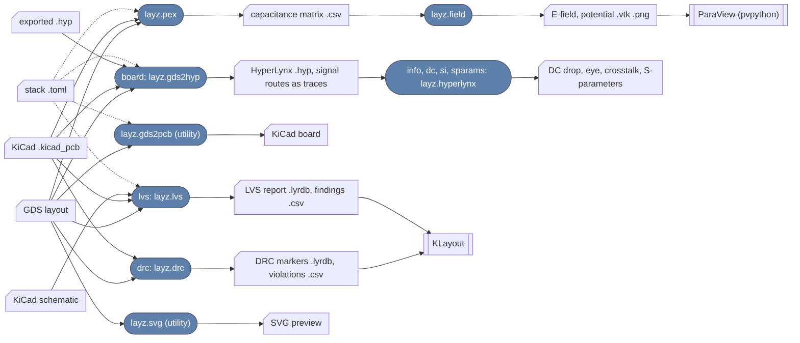

<p align="center"></p>

Layout tools for SiLab's FR4 PCBs, in-house RDL chips (maskless lithography) and the flex PCBs
that connect them, as one command line tool. Install: [docs/install.md](docs/install.md).

```
layz run FLOW    a design's flow (its flow.py, or the folder with it): its targets, in order
layz web         the runs in a browser, on port 8003: http://HOST:8003/
layz doctor      which external tools this machine has, then the tests
```

Everything else is layz's Python API, which a design's `flow.py` calls, one module per tool:

```
layz.drc         design rules: a GDS with gdscheck and the kit's deck, a board with KiCad's DRC
layz.lvs         connectivity vs the KiCad schematic (net and pin labels; KiCad's parity for boards)
layz.gds2hyp     GDS, .kicad_pcb or .hyp -> HyperLynx .hyp (signal pours as traces)
layz.pex         3-D capacitance matrix with FasterCap/FastCap2 (GDS + stack, or .kicad_pcb)
layz.field       electric field and potential of a pex run solved with charges
layz.hyperlynx   DC drop, SI, crosstalk and S-parameters in HyperLynx

utilities:
layz.gds2pcb     GDS -> KiCad .kicad_pcb (zones, footprints, vias, outline, stackup; nets from the GDS's labels)
layz.svg         GDS -> SVG preview
```

## Pipeline

Each box is a step of a flow (a target calling that module); the inputs are named in its `setup`.



## Repository

```text
layz/
├── layz/                 the layz package, one folder per tool:
│   ├── drc/  lvs/        design rules, connectivity
│   ├── gds2pcb/          GDS -> KiCad board (a utility)
│   ├── gds2hyp/          GDS, board or .hyp -> HyperLynx .hyp (traces.py: pours -> traces)
│   ├── hyperlynx/        HyperLynx (runner/: scripts in HyperLynx's own Python)
│   ├── pex/  field/      capacitance, fields (field/paraview/: scripts for pvpython)
│   ├── svg/              GDS -> SVG (a utility)
│   └── cli.py, flow.py, doctor.py, stack.py, plotstyle.py, solvers.py
├── tech/                 processes: stack file, DRC deck, notes
│   ├── uni-bonn-rdl/
│   └── multicb/          Multi-CB FR4 and flex buildups
├── designs/              real designs and their flows (ivtx_rdl: the obelix1 ladder)
├── test/                 layz's tests and their small test designs (run by layz doctor)
├── docs/                 install, stack file format, images
├── install.sh            install layz and its tools, per user, no sudo
└── install/              system.sh (the system packages, once per machine, by an admin) and
                          the steps install.sh runs: layz, fastercap, gdscheck, paraview, kicad
```

A process is given by name (`stack="uni-bonn-rdl"`, `kit="uni-bonn-rdl"`) or as a stack file;
the format is in [docs/stacks.md](docs/stacks.md).

## Flows

A design's whole flow, from DRC and LVS to SI and power, is the **targets** of its `flow.py`:
each step a function decorated `@target`, without arguments or return value. A target takes the
inputs it needs, runs a tool through layz's Python API, checks the results against the design's
limits and plots them into its own output folder. `layz run` runs them in the file's order and
stops at the first that fails:

```sh
export MGLS_LICENSE_FILE=27504@nexus.physik.uni-bonn.de   # HyperLynx's license server
layz run designs/ivtx_rdl                                 # its flow.py: every target, in order
layz run path/to/flow.py                                  # a flow file elsewhere
```

The first target, `setup`, names the inputs (as globals the later targets read): the layout (a
GDS or a KiCad board), its stack, the schematic, the board HyperLynx simulates. One from
[designs/ivtx_rdl/flow.py](designs/ivtx_rdl/flow.py):

```python
from pathlib import Path
from layz.drc import analysis as drc_analysis
from layz.drc import run as drc_run
from layz.flow import target

HERE = Path(__file__).parent
RESULTS = Path("results/ivtx_rdl")


@target
def setup():
    """The inputs: the layout, its stack and schematic."""
    global LAYOUT, STACK, SCHEMATIC
    LAYOUT = HERE / "obelix1_ivtx_ladder_v2.gds"
    STACK = "uni-bonn-rdl"  # tech/uni-bonn-rdl/stack.toml
    SCHEMATIC = HERE / "obelix1_ivtx_ladder_f.kicad_sch"


@target
def drc():
    """The layout against the Uni Bonn RDL's design rules (gdscheck, tech/uni-bonn-rdl)."""
    checked = drc_run.drc(LAYOUT, RESULTS / "drc", kit="uni-bonn-rdl", suite="main", topcell=None, tile=20000.0)
    drc_analysis.violations(checked, max_violations=0, out=checked / "violations.csv")
```

[designs/flex_ivtx/flow.py](designs/flex_ivtx/flow.py) is the same for a KiCad board.

## The log, and `layz web`

While a flow runs, every line of every tool it calls comes to the terminal, one line each with
its time, level and the tool that said it (`layz.log`):

```
13:41:04 INFO  [flow]       [2/5] drc: The route against the Uni Bonn RDL rules (geometry suite).
13:41:04 INFO  [gdscheck]   [RDL.M1.width] Checking min_width >= 10.00 µm on layer M1 (1/0)
13:41:04 ERROR [gdscheck]   Status: FAIL (2 violation(s))
13:41:50 WARN  [fastercap]  dummy dielectric-dielectric interface found in the input file, skipping
```

INFO in green, WARN in yellow, ERROR in red (NO_COLOR turns the colours off); the level is the
tool's own where it tags its lines, else read from the words. The run is recorded in
`results/<design>/`: `run.json` (each target's status, time, error, and the inputs `setup`
named) and `run.log` (the log).

`layz web`, from the repo, serves those runs on port 8003 (the same idea as FRIDA's viewer on
8001: on juno, `http://juno.physik.uni-bonn.de:8003/`). The first page lists the designs and their
last run; click one to open it:

* **RUN**: the inputs, then the targets top to bottom with their status and time; each opens to
  its tables (the CSVs it wrote: DRC rules, LVS findings, DC drop, eyes, ...) and its log.
* **PLOTS**: every plot the targets wrote, by target (click to enlarge).
* **LAYOUT**: the board the flow simulated (its `.hyp`): copper layer by layer (click a layer in
  the stackup to hide it, click copper to see its net and pins), the stackup with thicknesses,
  trace widths, via sizes and spans, and the board's counts.

## The API

Every tool has the same API, one package each: `run` runs it into a folder with every option
given (keyword-only, no defaults: each target says every setting it uses, so it reads on its
own), `analysis` checks the results against limits (a table, printed and written as CSV),
`plots` plots them in `layz.plotstyle`:

| | run | analysis | plots |
| --- | --- | --- | --- |
| design rules | `layz.drc.run.drc` (GDS), `board` (KiCad) | `layz.drc.analysis.violations` | KLayout markers (`drc.lyrdb`) |
| connectivity | `layz.lvs.run.lvs` (GDS), `board` (KiCad) | `layz.lvs.analysis.findings`, `parity` | KLayout markers (`lvs.lyrdb`) |
| HyperLynx board | `layz.gds2hyp.convert.hyp` | | |
| capacitance | `layz.pex.run.capacitance` | `layz.pex.analysis.coupling`, `totals` | `layz.pex.plots.matrix` |
| E-field | `layz.field.run.field` | | cross-sections (PNG/PDF), VTK |
| DC, SI, S-parameters | `layz.hyperlynx.run.dc`, `si`, `sparam`, `info` | `layz.hyperlynx.analysis.*` | `layz.hyperlynx.plots.*` |

Each function's docstring documents its options. The markers open in KLayout over the GDS:
`klayout design.gds -m results/.../drc.lyrdb`.

### Design rules: layz.drc

```python
checked = drc_run.drc(LAYOUT, RESULTS / "drc", kit="uni-bonn-rdl", suite="main", topcell=None, tile=20000.0)
checked = drc_run.board(PCB, RESULTS / "drc", refill_zones=True, all_track_errors=False)
drc_analysis.violations(checked, max_violations=0, out=checked / "violations.csv")
```

A GDS goes through [gdscheck](https://github.com/aesc-silicon/gdscheck) with a kit's deck:
`suite="geometry"` leaves out density, `tile` is gdscheck's merge tile (20 mm: board/RDL
scale). A KiCad board goes through KiCad's own DRC, with the rules in the board. Rules of the RDL
kit: [tech/uni-bonn-rdl](tech/uni-bonn-rdl/readme.md).

### Connectivity: layz.lvs

Compares a layout's connectivity with a KiCad schematic, net by net (interconnect has no
devices to recognise). KLayout extracts the nets from the stack's copper and via layers; text
labels say what each net is meant to be.

```python
checked = lvs_run.lvs(LAYOUT, RESULTS / "lvs", stack=STACK, schematic=SCHEMATIC)  # .kicad_sch or .net
lvs_analysis.findings(checked, out=checked / "summary.csv")
checked = lvs_run.board(PCB, RESULTS / "lvs", refill_zones=True)  # KiCad's schematic parity
lvs_analysis.parity(checked, out=checked / "summary.csv")
```

**Labels.** A label names the net whose copper its **origin** lies on:

* **pin label**: text = `REF.PIN` of a schematic pin (`V4.102`); put one on the pad at each end
  of a route and every connection is checked against the schematic;
* **net label**: text = a schematic net name (`D4_N` or `/D4_N`, case-insensitive).

They go on each metal's **pin layer: the same layer number, datatype 1** (M3 drawn on 6/0 is
labelled on 6/1, M2 3/0 on 3/1, pads 8/0 on 8/1). Texts on the drawing layer itself count too;
a stack can name other label layers (`labels = [...]`).

**Reported:** open (one schematic net on several layout nets), short (one layout net carrying
several schematic nets), unknown (a label naming nothing in the schematic), floating (a label on
no copper), and the schematic nets no label covers. `analysis.findings` fails on opens, shorts
or unknown labels. A chip's own pad names (VINA, VDDA, …) are not board nets: label the board on
the pin layers.

### HyperLynx board: layz.gds2hyp

HyperLynx `.hyp` from a GDS (directly, with KLayout: no KiCad), a KiCad board, or an existing
`.hyp`.

```python
gds2hyp.hyp(LAYOUT, BOARD, stack=STACK, refill=False, traces="auto", trace_max_width=0.08)  # nets, pins from the GDS's labels
gds2hyp.hyp(PCB, BOARD, stack=None, refill=True, traces="auto", trace_max_width=0.08)       # the board's own stackup
gds2hyp.hyp(EXPORTED, BOARD, stack=None, refill=False, traces="auto", trace_max_width=0.08) # rewrite a .hyp exported elsewhere
```

`traces="none"` keeps KiCad's own output, `traces="/CLK_P,/CLK_N"` writes traces for just these
nets. From a GDS, every net is named by its net labels and every pin label (REF.PIN) becomes a
pin on the pad under it, a device per REF; layers keep the stack's names (M3, P3, ...). A net
without a label stops it, as in `layz.gds2pcb`. From a KiCad board, the writer reproduces KiCad's
GUI exporter (records and number format). **Signal routes as traces** (`traces="auto"`): a GDS
draws every route as a polygon, which KiCad exports as a pour, and HyperLynx BoardSim builds
transmission lines, loss and crosstalk only from traces. So strip-shaped pours of signal nets are
written as their centreline (SEG records), as wide as the strip and run into the pads, vias and
pins at their ends; supplies and planes stay pours (right for DC drop). `auto` takes nets with
≥ 2 pins that are ≥ 95 % strips no wider than `trace_max_width` (0.08 mm). On the obelix1 export
that is the 17 signal nets (CLK, CMD, rst, D1–D4, ADC_1–4: 40 µm, 9 to 131 mm), which HyperLynx
then sees with their lengths and coupling.

### DC, SI and S-parameters: layz.hyperlynx

For HyperLynx the usual targets are `info`, `dc`, `si` and `sparams`, after `setup` and `board`.
Each names its own files, nets, limits and every HyperLynx setting it uses (`layz.hyperlynx.run`
documents them); one from [designs/ivtx_rdl/flow.py](designs/ivtx_rdl/flow.py), shortened:

```python
from layz.hyperlynx import analysis, plots, run


@target
def dc():
    """DC drop of the 3 V rails and their returns, against 5 %."""
    out = RESULTS / "dc"
    supply = run.dc(BOARD, out / "supply", license="HyperLynx SI/PI", nets=["/3V_1", "/3V_2", "/3V_3", "/3V_4"], include_ref=True, ...)
    ret = run.dc(BOARD, out / "return", license="HyperLynx SI/PI", nets=["/3V_1", "/3V_2", "/3V_3", "/3V_4"], include_ref=True, ..., return_from=supply / "ports.csv")
    analysis.dc_drop(supply, max_drop=0.05, out=out / "dc_drop.csv")
    plots.plot_dc(supply, out, ret)
```

The analyses (`layz.hyperlynx.run`) each copy the board into a run folder (with its `.bud`/`.pjh`
project: VRMs, DC sinks, pin models made in the GUI) and run there:

* `run.info`: stackup, nets with their lengths, VRMs, modelled pins.
* `run.dc`: DC drop: pin voltages and currents, every via's current, HyperLynx's CSV report,
  its PowerScope file and loss map; `return_from=` re-solves the return nets as the supply
  (HyperLynx maps supply nets only).
* `run.si`: waveforms (`std`, `osc`) or an eye (`eye`, PRBS) of a net, with real line models
  (or `lossy=False`, ...), `crosstalk=True`, `aggressors=` switched with HyperLynx's stock IBIS
  driver, `jitter=` in seconds. Needs `xvfb-run` (BoardSim reports to EZwave).
* `run.sparam`: S-parameters between pins, as Touchstone.
* `analysis.dc_drop`, `analysis.eyes`, `analysis.crosstalk`, `analysis.sparams`: checks of run
  folders against limits (drop per rail, eye height and width, crosstalk p-p, insertion and
  return loss), printed as a table and written as CSV.
* `plots.plot_dc`, `plots.plot_si`, `plots.plot_sparam`: plots of run folders in the plot style
  of `layz.plotstyle`. `setup.prepare()` finds HyperLynx and builds its writable overlay.

Install, overlay and license come from `LAYZ_HYPERLYNX_HOME` (the `SDD_HOME` folder; found under
`/eda/Siemens` otherwise), `LAYZ_HYPERLYNX_OVERLAY` and `MGLS_LICENSE_FILE`. How the API is
driven is in [layz/hyperlynx](layz/hyperlynx/__init__.py).

### Capacitance and fields: layz.pex, layz.field

3-D capacitance matrix (FasterCap, or FastCap2), and the field of a solved run.

```python
from layz.field import run as field
from layz.pex import analysis, plots, run as pex

caps = pex.capacitance(PCB, RESULTS / "pex", stack=None, ..., charges=True, ...)  # stack from the board
caps = pex.capacitance(LAYOUT, RESULTS / "pex", stack=STACK, ..., charges=True, ...)  # a GDS with its stack
analysis.coupling(caps, max_coupling_fF=50.0, out=caps / "coupling.csv")
plots.matrix(caps, caps)
field.field(caps, voltages={"TOP": 1.0}, plane=None, ...)       # 3-D grid -> field.vtk
field.field(caps, voltages={"TOP": 1.0}, plane="y=5000", ...)   # cross-section, PNG + VTK
```

A conductor is any copper that touches or is joined by vias, named by net (KiCad), by GDS texts
or `names={NAME: (LAYER, X, Y)}`. Results: `maxwell_matrix_fF.csv` (Maxwell convention: diagonal
total, off-diagonal −mutual) and `spice_caps_fF.csv`. **Keep `tolerance` at 0.01 or tighter**:
with dielectrics FasterCap's first passes can be far off without an error. `charges=True` keeps
the panel charges `layz.field` needs. Its `voltages` set conductor voltages for the field only;
any bias is a superposition of the solved columns, so it needs no new solve; `probes` prints φ
and E at given points.

The field's results open in ParaView, with scripts run by ParaView's own Python (on Ubuntu with
`HWLOC_COMPONENTS=-gl` set); each takes `-h`:

```sh
pvpython layz/field/paraview/section.py RUN/section_y5000_edge.vtk   # heatmap + field lines
pvpython layz/field/paraview/geometry.py RUN                         # the 3-D model
pvpython layz/field/paraview/view.py RUN                             # conductors, a cut plane, arrows
```

### Utilities: layz.gds2pcb, layz.svg

A GDS as a KiCad board, to look at or edit in KiCad (no analysis needs it), and a GDS as SVG:

```python
from layz.gds2pcb.convert import convert
from layz.svg.render import render_gds_to_svg

convert(LAYOUT, Path("design.kicad_pcb"), stack="uni-bonn-rdl", scale_mm_per_um=1.0, drill_shrink_um=10.0, flip_y=True)
render_gds_to_svg(LAYOUT, Path("design.svg"), scale_mm_per_um=0.001, width_px=2000, flip_y=True)
```

GDS cells with pad-layer shapes become footprints (one per cell and orientation), top-level
copper becomes filled zones, via layers become blind/buried vias, the outline layer becomes
Edge.Cuts, and the stack becomes the board's physical stackup; Y is flipped so the board shows
the GDS top view (`flip_y=False` keeps it raw). Every zone, via and pad gets its net, named by
the GDS's net labels (the same labels `layz.lvs` reads): a net without one stops it, as does a
net with two names (a short) or a net label on no copper.

## layz doctor

```sh
layz doctor                                               # which tools are installed, then the tests
```
